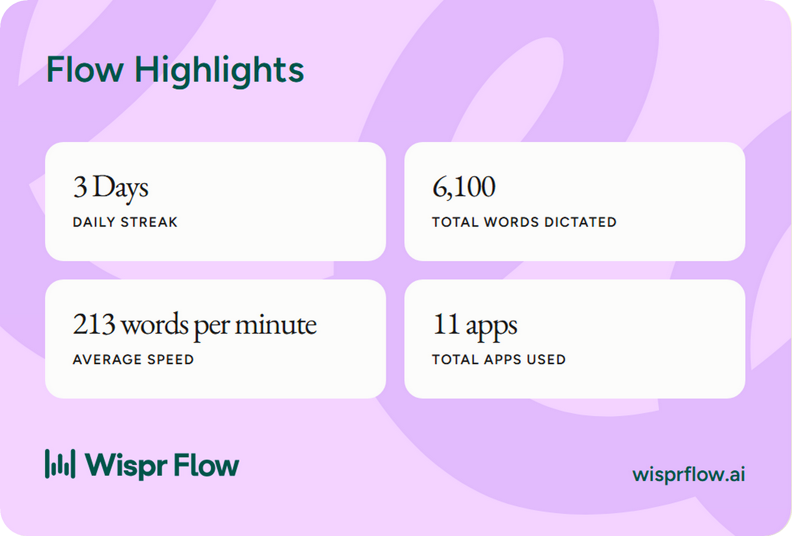
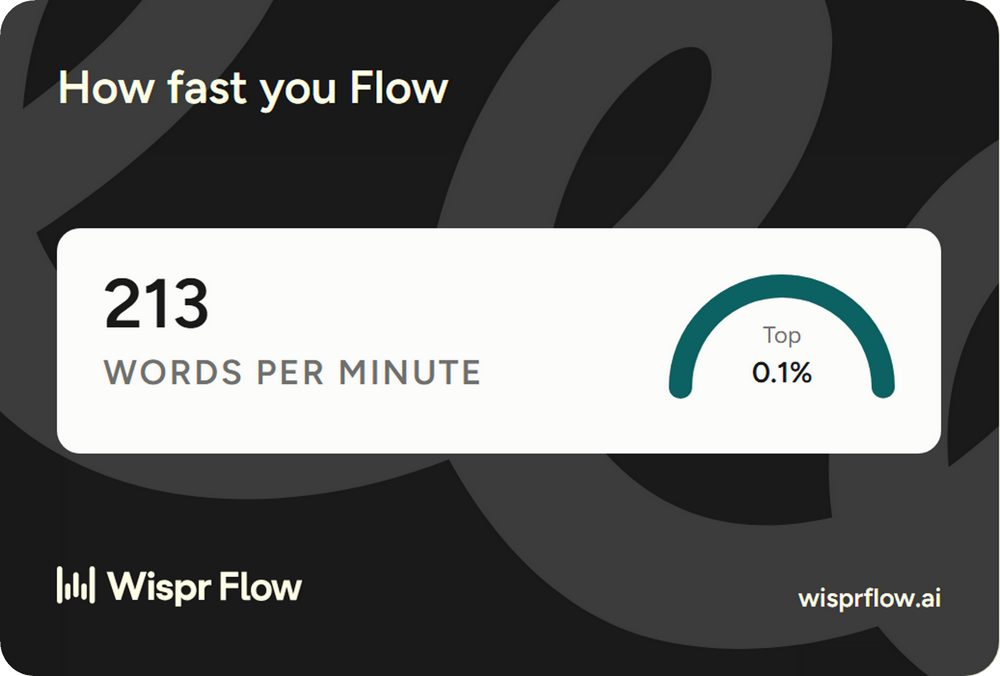
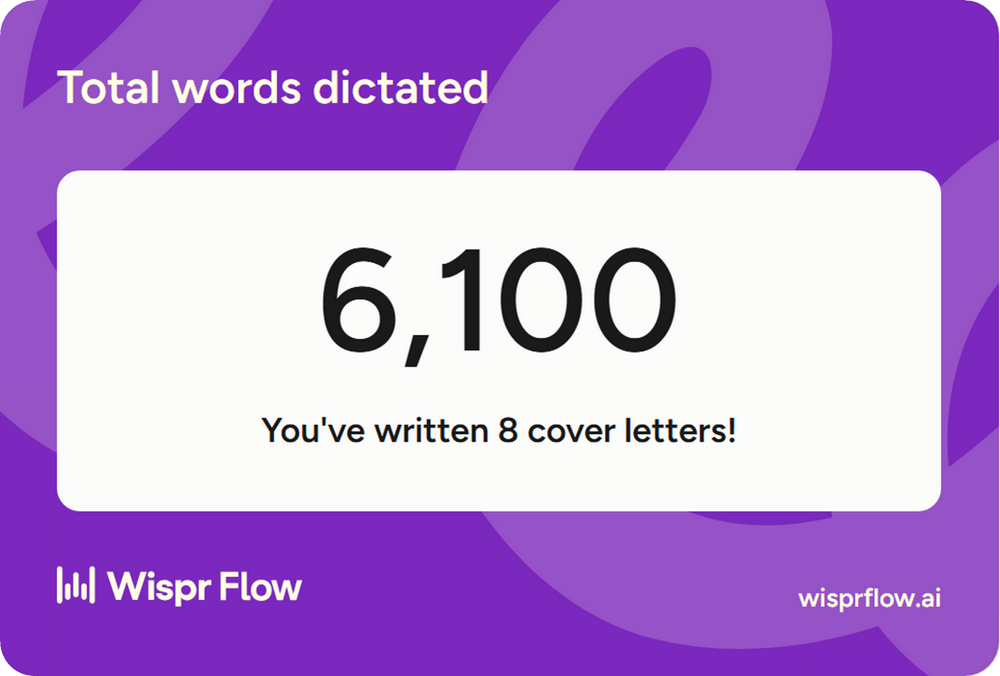
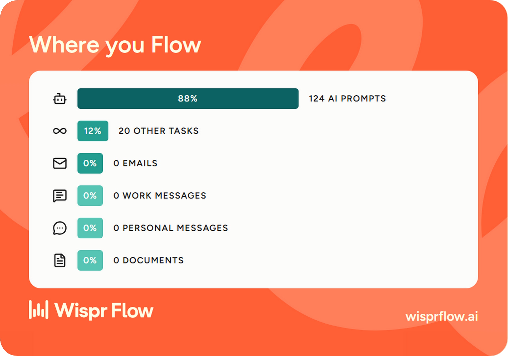
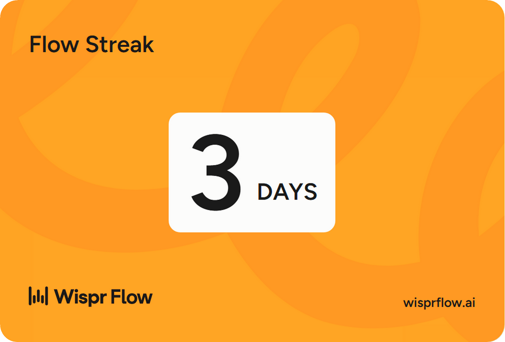
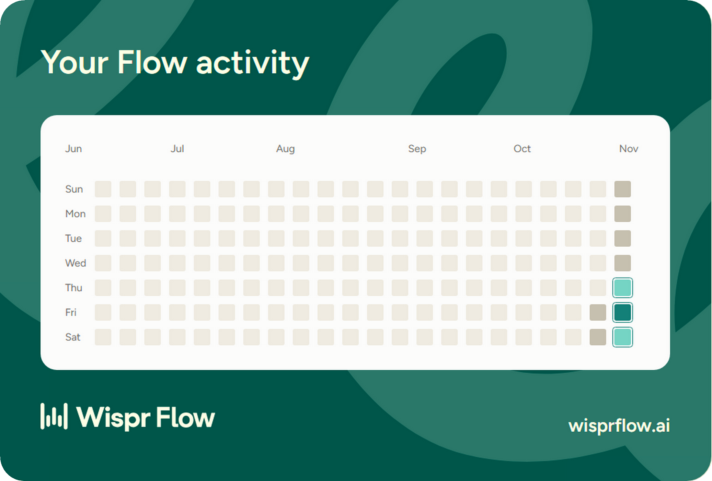
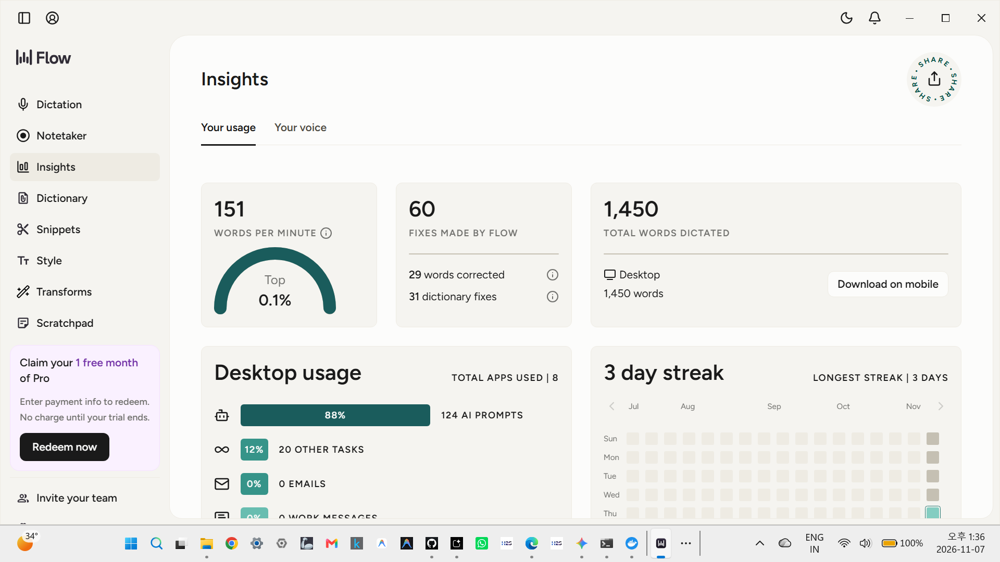

# 🛡️ A.U.R.A. — Autonomous Unified Response Agents

**Human-in-the-loop security incident triage, running as a team of AI agents in a Switch room.**

> **Flip the Switch Hackathon** · Team: `aura` (lead: @snehathumar) · Track 1 — Best Business Workflow  
> **Demo video (OneDrive Cloud Stream):** [Watch Live Video Walkthrough](https://1drv.ms/v/c/2b13bd8cb0e5c2dd/IQA2jMKnnFWPR5vsMPITMbR2AR3h2E9Eg1PeOK-E3sprv6c?e=gMZjrr)  
> **Interactive Web Demo:** https://ais-pre-qjnd5iymcdcnfitfqq3fkg-922040312159.asia-east1.run.app  
> **GitHub Repository:** https://github.com/snehathumar/aura-switch-triage  

---

## The problem

Security alerts arrive in many tools. An analyst copies logs into a chat, decides the severity by hand, searches for the right containment command, and then writes the post-incident report afterwards. Context gets lost between people and tools.

## What A.U.R.A. does

A.U.R.A. moves that loop into one Switch room. A person posts an alert and tags **one** agent. The agents then hand the work to each other and stop for a human before anything is closed.

```
 Human:   @aura-triager <alert>
             │
             ▼
 aura-triager   summarizes the alert, classifies it
                (Critical Incident / False Positive / Policy Question)
             │  Critical Incident only → tags aura-repro
             ▼
 aura-repro     proposes the smallest containment steps and explains them.
                It does NOT run anything. Asks a human to approve.
             │
             ▼
 Human:   @aura-repro approved
             │
             ▼
 aura-reporter  writes the incident report from facts in the room thread
```

The room history is the audit trail. The agents remember earlier incidents in the room (for example, they keep two different attackers on separate watch lists).

## How we used Switch

- **Local Switch server** started by **Switch Console (v0.40.1)** on Windows, with the **bundled Mattermost** as the chat app.
- **Three workflow agents** on **OpenCode**: `aura-triager`, `aura-repro`, `aura-reporter` (Console also shows the default `switch-buddy-admin` helper, which is not part of the workflow).
- **One room, `#aura-triage`**, with **room instructions** that Switch sends to every agent when it joins the room. They set the workflow rules: agents only propose, humans approve, and an agent never states that a fix was applied unless a human confirmed it.
- **Agent-to-agent handoff** by @mention inside threads. In Switch, agents answer when they are mentioned, so a human tags only the first agent and approves once.
- **Per-agent instructions** in `aura-triage.yaml` (roles for triage, containment proposals, and reporting).

## Safety and honesty

- **All alerts in the demo are synthetic** (`sample-alerts.txt`). There is no real server, AWS account, or production system behind them. Addresses use reserved documentation ranges (`203.0.113.0/24`, `198.51.100.0/24`, `192.0.2.0/24`).
- **Agents propose commands; humans run them.** The agents have no access to any real infrastructure.
- **Limitation:** "human approval first" is enforced by room and agent instructions, not by a technical gate. A production setup would add per-agent least-privilege access and real approval controls.

## Reproduce it

**Requirements:** Docker Desktop (running), Switch Console, and one agent provider. We used **OpenCode** with a model API key (do not commit keys).

1. Install and start **Docker Desktop**.
2. Install **Switch Console** (from the hackathon Resources page or the Switch releases). On first start choose **Run a server on this computer** and wait for it to finish its first-time download.
3. Install **OpenCode** (`npm install -g opencode-ai`), then connect a model provider.
4. In Switch Console, create three agents with provider **OpenCode**: `aura-triager`, `aura-repro`, `aura-reporter`. Use the roles and instructions from [`aura-triage.yaml`](aura-triage.yaml).
5. Create a room named `aura-triage`, add the three agents, and paste the room instructions from the **Room instructions** section below into the room's **Configuration** tab.
6. Post an alert from [`sample-alerts.txt`](sample-alerts.txt), tagging the first agent:  
   `@aura-triager ALERT: 342 SQL injection attempts on web-03 exfiltrating 4.1MB from 198.51.100.24`
7. When `aura-repro` asks for approval, reply in its thread: `@aura-repro approved`

### Room instructions

```
Team A.U.R.A. Security Operations & Threat Triage Center.

Workflow:
- People post security alerts, suspicious logs or CVEs here. Only aura-triager responds to a new alert.
- aura-triager summarizes the alert in one line, classifies it (Critical Incident, False Positive, or Policy Question) and, for a Critical Incident only, hands off to aura-repro by tagging it.
- aura-repro proposes the smallest containment commands, explains them, and asks the human on call for approval. Agents only propose; humans run any command.
- After the human approves, aura-repro tags aura-reporter, which writes the incident report.
- Never state that a fix was applied or verified unless a human confirmed it in this room.
```

## Extra: interactive mock (not the live Switch run)

This repo also contains a small web app that **simulates** the room flow with Gemini-generated replies, for people who want to click through the idea without installing Switch. **It is not connected to Switch and is not the live demo.**  
🔗 **Live Interactive Applet:** [https://ais-pre-qjnd5iymcdcnfitfqq3fkg-922040312159.asia-east1.run.app](https://ais-pre-qjnd5iymcdcnfitfqq3fkg-922040312159.asia-east1.run.app)

## Built with Wispr Flow (Code with Wispr side track)

We used **Wispr Flow** to dictate prompts to AI assistants, architect multi-agent rules, and draft documentation.
Wispr Flow Insights at the time of submission: **151 words per minute (shown as "Top 0.1%" in the app)**, **1,450 words dictated**, and **3 days streak** with **88% AI Prompts**.

### Verified Telemetry Proofs (Line by Line):

1. **Flow Highlights:**  
   

2. **Top 0.1% Speed Proof (151 WPM):**  
   

3. **Total Words Dictated (1,450 Words):**  
   

4. **AI Prompts Breakdown (88% Prompts):**  
   

5. **3-Day Development Streak:**  
   

6. **Activity Heatmap Telemetry:**  
   

7. **Full Desktop Telemetry Scorecard:**  
   

## Limitations and next steps

- Approval is policy, not an enforced gate.
- Agents do not read real log sources yet. Next step: read-only connectors (for example logs and tickets) with least-privilege access per agent.
- Quality depends on the model behind each agent.

## License

Apache-2.0
